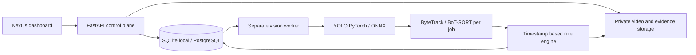

# SentinelVision architecture

The local queue uses atomic database claiming and expiring leases. Inference never runs inside request handlers. Every stored entity is scoped by tenant; bearer sessions expire and are revocable through database sessions. Videos and evidence are served only after authorization. Rule coordinates are normalized image coordinates. Proximity is image-space only unless a validated calibration exists. No face recognition or cross-camera identity matching.

Production hardening requires deployment-specific TLS, secrets, worker resource isolation, storage policy and external integration validation. Single-worker SQLite is the tested local profile; distributed PostgreSQL/Redis/S3 behavior is separately documented.

Camera capture jobs use encrypted source configuration, resolved-IP pinning and a decoder thread with a two-frame drop-oldest queue. The inference worker owns a fresh tracking session, source-PTS rule state with receive-time fallback and attempt-scoped artifact directory. It saves per-frame trajectories, previews, H264 playback and event clips. Optional S3 persists private source/evidence objects; tenant checks precede presigned access.

Job creation commits an outbox row with the job. Database polling is the verified execution path; optional Celery dispatch reads the outbox and retries broker failures. Atomic claims issue random tokens. Every metadata publication is conditional on the current unexpired token, so stale workers cannot overwrite a replacement attempt. Review state is separate from event active/resolved/session-ended state.

Host-qualified worker heartbeats and shared maintenance support the operational dashboard. Tenant-scoped deletion removes metadata and commits a durable cleanup task in the same transaction, then retries storage side effects; an audit row is preserved. Local DB/object deletion is not a distributed transaction; external object lifecycle and immutable audit policies remain deployment responsibilities.

Shared service leases fence camera scheduling and maintenance. Continuous monitoring schedules independent bounded jobs; identities and recording continuity do not span segments. Public JSON endpoints declare response schemas; core entities have named models, while extensible audit/telemetry payloads use JSON-value maps. Internal storage remains a generic JSON record table intentionally. Model and rule snapshots make queued inference reproducible; capability gates prevent activating unvalidated industrial classes.
