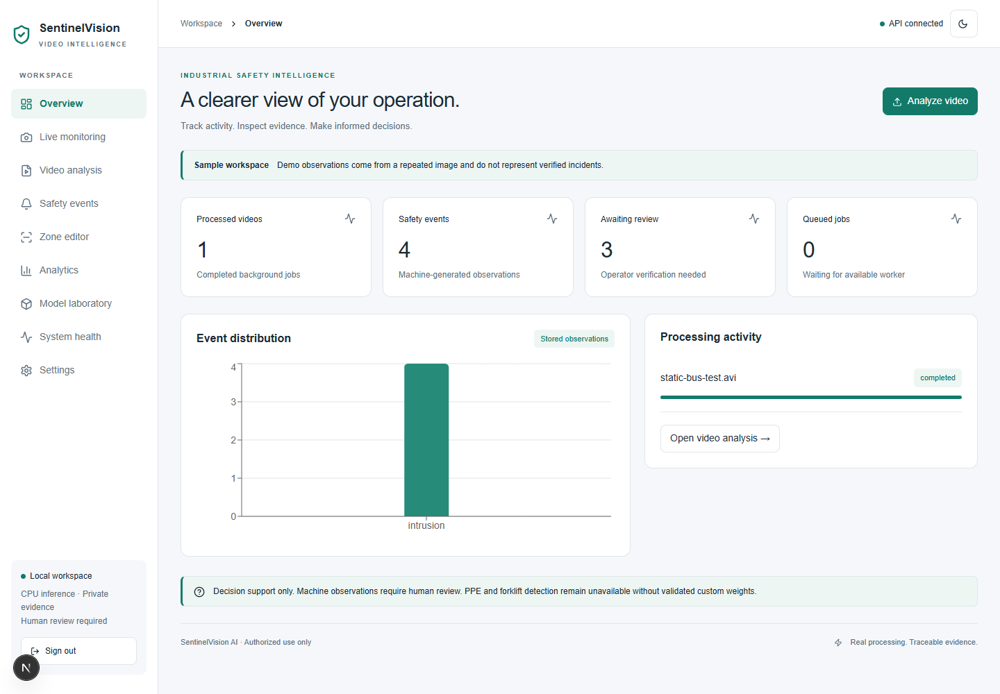
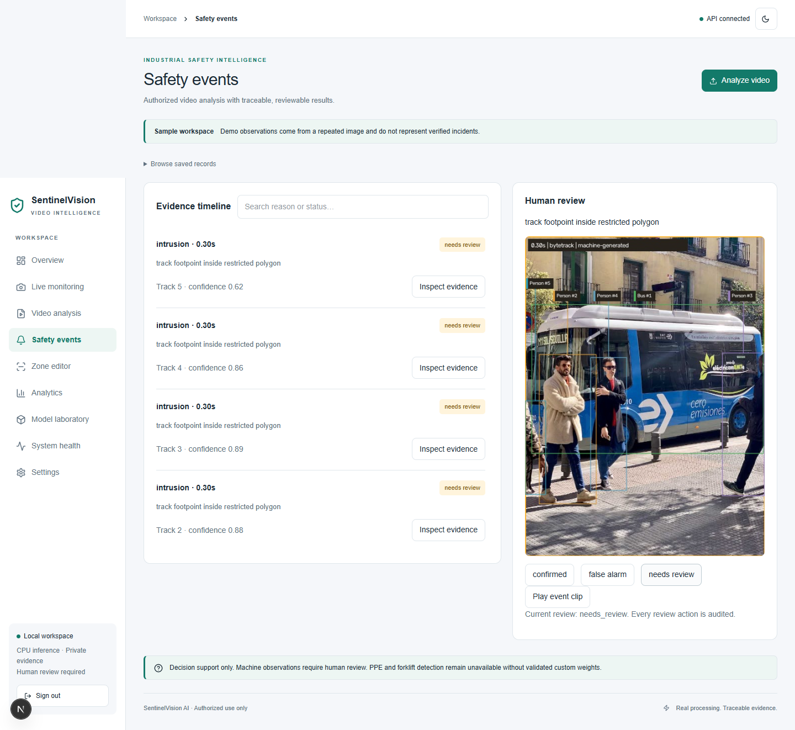
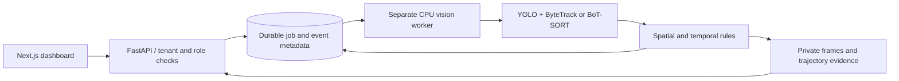

# SentinelVision AI

An executable local video-intelligence and safety-evidence platform. Upload authorized footage, run real YOLO detection with isolated ByteTrack or BoT-SORT tracking, evaluate deterministic zone rules, and review timestamped annotated evidence in a Next.js dashboard.

**Status: verified CPU prototype, not a finished enterprise safety product.** Supervised segmented live capture, timestamp-preserving playback, tenant controls, model registry, durable cleanup and security hardening are implemented; industrial/PPE evaluation and distributed deployment still need external validation. See [implementation status](IMPLEMENTATION_STATUS.md) for the full acceptance matrix.



## What works

- Authenticated, tenant-scoped FastAPI API with Argon2 passwords and expiring, server-revocable sessions and database-shared rate limits.
- Validated video upload, durable background jobs, progress, cancellation, retry, fenced claims, transactional outbox and expired-lease recovery.
- Real YOLO11n inference, configurable ByteTrack/BoT-SORT, per-frame trajectory artifacts.
- Polygon intrusion, dwell, occupancy and directional line rules; timestamp persistence, cooldown and duplicate suppression.
- Private annotated evidence, H264 playback/event clips, optional S3 persistence, automatic retention and audited review/deletion.
- Responsive light/dark dashboard, upload UI, polygon editor, event search, stored-data charts and explicit unsupported-feature states.
- Encrypted, allowlisted RTSP capture with bounded buffers, preview/drop/reconnect telemetry, worker health, analytics and admin account provisioning.
- Source-group dataset preparation with near-duplicate screening, actual transfer-learning script, MLflow logging, ONNX export/agreement checks and measured CPU benchmarks.

Industrial forklift/PPE classes are unavailable in the generic model. Metric proximity and explicit negative-PPE association are implemented but activation requires validated capabilities and, for proximity, measured camera calibration. No face recognition or cross-camera identity profiling.

## Start locally

Python 3.12, Node 22+ and `uv` are required. From the repository root:

```powershell
uv sync --frozen --group ml
npm ci --prefix apps/web
.venv/Scripts/python.exe scripts/bootstrap.py
```

Start the supervised local stack:

```powershell
.venv/Scripts/python.exe scripts/supervise.py api worker maintenance web
```

Or start three terminals for upload-only development:

```powershell
./scripts/start-local.ps1 api
./scripts/start-local.ps1 worker
./scripts/start-local.ps1 web
```

Open **http://127.0.0.1:3000**. API documentation is at **http://127.0.0.1:8010/docs**. This authored checkout already has local credentials in ignored `data/local-login.json`; new installations create their own password with bootstrap. See [operations](docs/OPERATIONS.md) for Linux, migrations, retention and unexecuted Compose deployment commands.

## Reproduce the demonstration

With API and worker running:

```powershell
.venv/Scripts/python.exe scripts/demo.py
```

The script downloads a public sample image and repeats it into a three-second test video, then logs in, uploads, queues real inference, checks stored events, retrieves evidence and records review. **This static fixture verifies integration, not industrial accuracy.** The frontend labels demo data. Use the [four-minute interview script](docs/INTERVIEW_GUIDE.md) for an honest walkthrough.



## Architecture



See [architecture](ARCHITECTURE.md) and [implementation plan](IMPLEMENTATION_PLAN.md). The native path uses SQLite and private local files. PostgreSQL/Celery/Redis deployment paths are not validated by native tests.

## Train, evaluate and benchmark

```powershell
# Executed CPU training smoke; never report this as industrial quality
.venv/Scripts/python.exe ml/training/train.py --data coco8.yaml --epochs 1 --imgsz 320 --batch 2 --smoke

# Licensed custom data with source-video groups
.venv/Scripts/python.exe ml/training/prepare.py manifest.json --output data/prepared
.venv/Scripts/python.exe ml/training/train.py --data data/prepared/dataset.yaml --epochs 50
.venv/Scripts/python.exe ml/evaluation/detection.py --data data/prepared/dataset.yaml --models yolo11n.pt path/to/best.pt --split val

# Executed export and benchmark paths
.venv/Scripts/python.exe ml/export/export_onnx.py --image data/demo/bus.jpg
.venv/Scripts/python.exe ml/evaluation/benchmark.py --image data/demo/bus.jpg --output data/benchmarks/pytorch
.venv/Scripts/python.exe ml/evaluation/benchmark.py --model yolo11n.onnx --image data/demo/bus.jpg --output data/benchmarks/onnx
```

Recorded warmed CPU median model-call latency was **52.42 ms PyTorch / 44.08 ms ONNX**, at batch 1, fixed 640×640, five warm-up and 30 measured calls. ONNX had worse measured tail latency. This excludes decode/tracking/storage/network. See [benchmark scope and raw reports](docs/BENCHMARKS.md). No GPU result, real industrial mAP improvement or MOT benchmark is claimed.

Dataset provenance, duplicate/split validation, fixed held-out protocols and outstanding RQ1–RQ5 evaluations are described in [data and research](docs/DATA_AND_RESEARCH.md). COCO8 has a DVC pointer; no dataset, footage or weights are committed. MLflow stores local results in `data/mlflow.db`.

## Validate

```powershell
.venv/Scripts/pytest.exe -q --cov=sentinel
.venv/Scripts/ruff.exe check services scripts tests ml infra
.venv/Scripts/mypy.exe
npm run lint --prefix apps/web
npm run build --prefix apps/web
npm run typecheck --prefix apps/web
cd apps/web
npx playwright test
```

Browser tests use installed Edge on Windows and Chromium in CI. Run `python scripts/e2e_stack.py` with ports 8010/3000 free to start an isolated API/worker/web stack, create temporary credentials, execute real inference and all four browser workflows, then stop it. This launcher passed locally; GitHub Actions now invokes it, but no hosted CI run has occurred.

## Security, licensing and remaining work

Read [responsible use and limitations](docs/SECURITY_AND_LIMITATIONS.md) and [dependency/license matrix](docs/DEPENDENCIES.md). Ultralytics software/models require AGPL or Enterprise license review. Shared maintenance enforces tenant-configurable retention (seven-day default). Evidence uses authenticated local storage or optional S3 with authorized short-lived URLs; S3 HTTP behavior was tested against Moto. Immutable external audit logs and identity-provider integration remain pending. Full npm and Python audits report zero known findings; see current JSON reports in `docs/results`.

External needs: authorized physical cameras and clock calibration; licensed industrial/PPE datasets; real Redis/PostgreSQL/MinIO services; CUDA hardware; and production identity/cloud infrastructure. See the explicit external-resource and remaining-engineering tables in [implementation status](IMPLEMENTATION_STATUS.md). No cloud deployment has occurred.
